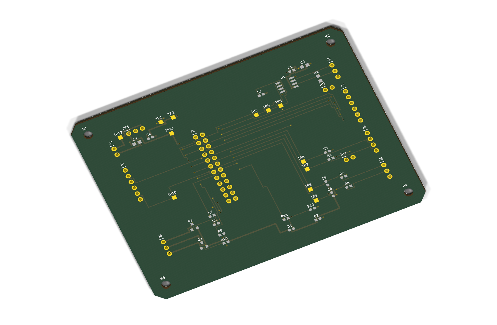

# Meridian Industrial Sensor Carrier · Revision B

Meridian is a four-layer PCB design for integrating a 3.3 V controller with RS-485, SPI, I²C, analog sensing, and low-side loads. Revision B adds a hardware supply selector, wider power routes, dedicated inner copper planes, and an editable schematic and layout tied to the same pin map.

[View all four copper layers](media/four-layer-inspection.png)

| Deliverable | Contents |
| --- | --- |
| [KiCad project](cad/meridian-carrier.kicad_pro) | Native schematic, PCB, project symbol and footprint libraries, and explicit routing constraints. |
| [Schematic PDF](reports/meridian-schematic.pdf) | Review drawing organized by electrical function. |
| [AutoCAD DXF](cad/meridian-carrier.dxf) | Millimetre model with board outline, mounting, drills, individual tracks, and separately editable inner plane models. |
| [Mechanical STEP](cad/meridian-carrier-board.step) | Board solid for enclosure fit, with mounting bores checked against the nonplated drill output. |
| [Assembly and purchasing](cad/bill-of-materials.csv) | Reference designators, package details, candidate manufacturer part numbers, and source links. |
| [Connector and jumper map](design-review.md) | Controller pinout, field connectors, power selection, and test points. |
| [Engineering basis](engineering-basis.md) | Component and fabrication references, electrical decisions, and the integration envelope. |
| [Fabrication review](fab/README.md) | Stack, drill, copper, and manufacturing checks for the prototype package. |
| [First-article acceptance](first-article.md) | Bench setup, measurable acceptance criteria, and evidence to collect. |

The board measures 101.60 × 76.20 mm and uses four 3.20 mm mounting holes. L2 provides a ground plane and L3 provides the 3.3 V plane. The two outer layers carry signal and power tracks. JP3 selects the controller supply or a regulated auxiliary input with a single shunt.

## Verify and regenerate

Install the Python dependencies in [requirements.txt](requirements.txt). Run the generators from the project root in this order.

~~~sh
python schematic.py
python route.py
python verify.py
python check_verifier.py
python planes.py
python export_cad.py
python render_preview.py
~~~

[Geometry evidence](verification.json) covers the routed copper, hole spacing, board edge, and connectivity. [Plane evidence](plane-verification.json) covers continuous inner pours and their isolation envelopes. [Export evidence](cad/export-checks.json) records the DXF audit and KiCad geometry readback. [KiCad 10.0.8 results](reports/native-summary.json) record zero electrical or layout findings, zero unconnected items, zero schematic parity issues, and agreement on all 124 electrical pad assignments. The [fabrication export check](reports/fabrication-summary.json) confirms nine Gerber layers, 117 plated and four nonplated drill hits, and 23 top-side surface-mount placements. See [the fabrication folder](fab/README.md) for export instructions and the file manifest.

[Mechanical readback](reports/mechanical-summary.json) compares the STEP solid with the board dimensions and all four mounting bores in the nonplated drill output. The STEP is for fit review and excludes fitted components. Its exported Z span reflects the KiCad model. Use the fabricator-approved stack and component heights to set actual enclosure clearances.

This handoff is for engineering and prototype review. Fabrication approval requires final part-to-footprint confirmation and review of the chosen fab stack. Hardware validation uses the documented bring-up plan.
