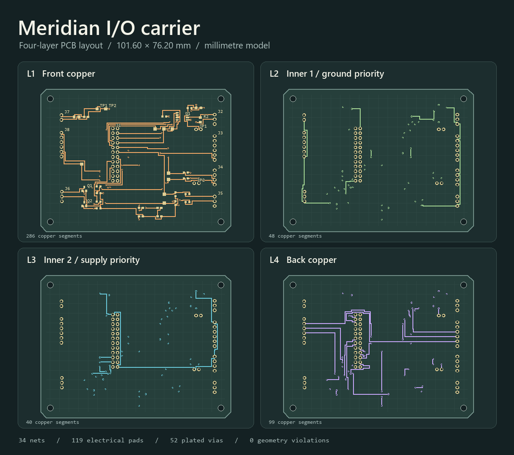

# Meridian Industrial Sensor Carrier

A four-layer PCB layout for a 3.3 V controller that needs field interfaces, analog sensing and bench test access. The project includes the editable AutoCAD DXF, a KiCad board, the source netlist, the routing code and a vector geometry verification report.

## Inspect the board

- [AutoCAD DXF](cad/meridian-carrier.dxf) contains the copper tracks, pads, drill geometry, component outlines and dimensions on named layers. Open it in AutoCAD at 1:1 in millimetres. Model space starts at the lower left corner.
- [KiCad PCB](cad/meridian-carrier.kicad_pcb) adds electrical net assignments to the same copper and pad geometry. Its origin is at the upper left corner.
- [Interface and assembly notes](design-review.md) document the controller pinout, default states and bench review steps.
- [BOM](cad/bill-of-materials.csv) and [pad net map](cad/pad-net-map.csv) identify the placement and connectivity.
- [Geometry report](verification.json) and [export checks](cad/export-checks.json) capture what was checked.

## Design decisions

The controller connector uses an explicit project pinout. The RS-485 transceiver shares one direction signal between driver enable and receiver enable, with a pull-down that starts it in receive mode. A removable link controls the 120 Ω termination. The I²C pull-ups can be disconnected to use bus pull-ups already on another device. Each analog input has a 1 kΩ / 100 nF low-pass network. Two 3.3 V controlled MOSFET channels provide low-side outputs for a bench resistive load. Exposed test pads cover power, reset, the bus and both ADC inputs.

The board routes signals primarily on the outside layers. Inner layer 1 favors ground routes and inner layer 2 favors 3.3 V routes. The router permits constrained signal crossings on the inner layers. It uses a 0.254 mm grid, minimizes via changes and reserves keepouts around pads and mounting holes. All geometry is generated from [the netlist and placement source](board.py).

## Reproduce and verify

~~~sh
python -m pip install -r requirements.txt
python route.py
python verify.py
python check_verifier.py
python export_cad.py
python render_preview.py
~~~

The verifier constructs actual vector copper shapes and independently checks inter-net clearance, hole clearance, board-edge clearance, mounting keepouts and electrical continuity. Two regression probes confirm it rejects an injected short and an open net. A separate reader reopens each export and checks its structure. The drawing uses the [AutoCAD DXF entity model](https://help.autodesk.com/cloudhelp/2018/ENU/AutoCAD-DXF/files/GUID-7D07C886-FD1D-4A0C-A7AB-B4D21F18E484.htm).

This is an unbuilt portfolio design. Before fabrication it needs schematic review, footprint and connector confirmation, signal integrity and load validation, and a fabricator-specific DRC. The inner layers contain routed copper. The design does not model solid reference planes or controlled impedance. Use the exposed pins only with the documented 3.3 V bench setup.

Device references: [TI THVD1450](https://www.ti.com/product/THVD1450) and [AOS AO3400A](https://www.aosmd.com/products/mosfets/low-voltage-mosfets-12v-30v/ao3400a).
